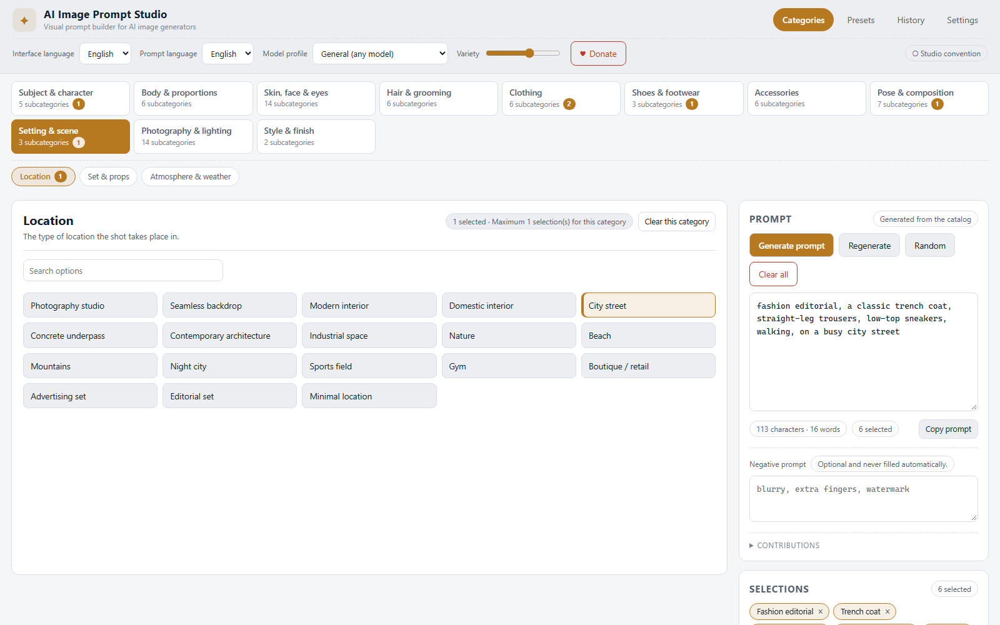
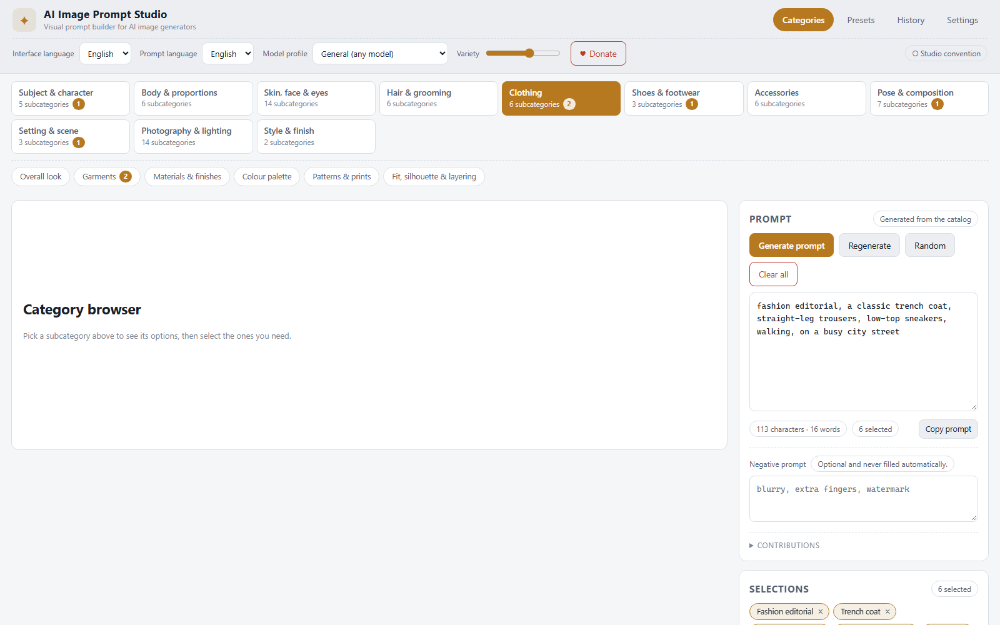
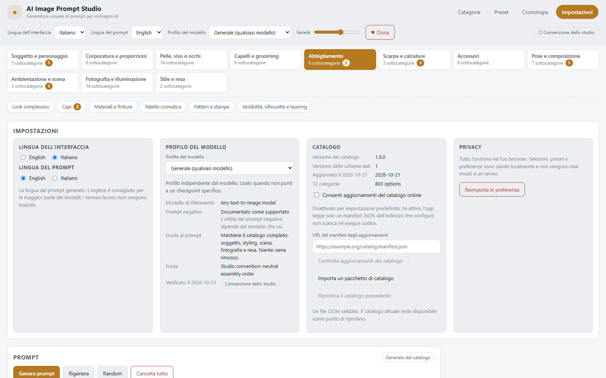

# AI Image Prompt Studio

**Un generatore visuale di prompt per immagini AI, completamente locale.**

AI Image Prompt Studio trasforma un catalogo curato e strutturato di
vocabolario moda, styling, fotografia e illuminazione in un prompt preciso e
pronto da incollare nel generatore. Scegli le opzioni dentro categorie
indipendenti; l'app le assembla in un prompt leggibile con un solo clic.
Nessuna API key, nessun modello da scaricare, nessun account: tutto gira nel
tuo browser e funziona offline dopo il primo caricamento.

> **Demo online:** <https://sasxdj-cmyk.github.io/ai-image-prompt-studio/>
> *(si usa nel browser, senza installare nulla — [avvialo in locale](#avvio-rapido) se preferisci)*



---

## Indice

- [In evidenza](#in-evidenza)
- [Avvio rapido](#avvio-rapido)
- [Come funziona il generatore](#come-funziona-il-generatore)
- [Categorie](#categorie)
- [Catalogo](#catalogo)
- [Profili dei modelli](#profili-dei-modelli)
- [Lingue](#lingue)
- [Preset, cronologia ed esportazione](#preset-cronologia-ed-esportazione)
- [Aggiornamenti del catalogo](#aggiornamenti-del-catalogo)
- [Struttura del progetto](#struttura-del-progetto)
- [Comandi](#comandi)
- [Test](#test)
- [Privacy](#privacy)
- [Limiti noti](#limiti-noti)
- [Roadmap](#roadmap)
- [Contribuire](#contribuire)
- [Licenza](#licenza)

---

## In evidenza

- **72 categorie e 803 opzioni** già pronte all'uso: al primo avvio non devi
  scrivere nulla a mano.
- **Le categorie sono sintetiche**: undici categorie di primo livello (soggetto,
  corporatura, aspetto, capelli, abbigliamento, calzature, accessori, posa,
  scena, fotografia, stile), ognuna con le proprie sottocategorie. Clicchi una
  sottocategoria e vedi le sue opzioni; ogni opzione scelta è una selezione
  che puoi annullare con un tag.
- **Generazione con un clic**: il prompt viene assemblato in modo deterministico
  dalle selezioni attive, in un ordine logico, senza informazioni duplicate o
  contraddittorie.
- **Categorie indipendenti**: cambiare le scarpe non azzera la posa, la luce o
  l'abbigliamento.
- **Le selezioni diventano tag**: ogni opzione scelta è un tag con una ×, così
  un cambio di idea è a portata di clic.
- **Risultato editabile**: il prompt generato è un normale campo di testo. Le
  modifiche manuali sono protette: l'app chiede prima di sostituirle.
- **Controllo di conflitti e ridondanze**: le combinazioni incompatibili (un
  abito con una camicia) e le ripetizioni vengono segnalate, il frammento in
  conflitto resta fuori dal prompt e la selezione resta visibile.
- **Random**: una combinazione casuale ma coerente dal catalogo locale, con un
  livello di varietà configurabile. Nessun servizio remoto, nessun modello AI.
- **Profili dei modelli** per Z-Image-Turbo, FLUX.1 [schnell], Qwen-Image-2.1,
  FLUX.2 e FLUX 3 Image Klein, ognuno con la fonte delle informazioni e lo
  stato di verifica.
- **Interfaccia in inglese e italiano**, con la lingua del prompt configurabile
  separatamente da quella dell'interfaccia.
- **Persistenza locale**: preferenze, preset, cronologia e sessione corrente
  sono salvati in `localStorage`. I dati corrotti vengono rilevati e recuperati.
- **Funziona offline**: un service worker mette in cache l'applicazione, quindi
  lo studio continua a funzionare senza connessione.
- **Catalogo aggiornabile**: i nuovi contenuti si distribuiscono come pacchetti
  JSON versionati, importabili o scaricabili, senza reinstallare l'applicazione
  e senza scaricare codice eseguibile.

## Avvio rapido

Requisiti: **Node.js 20.19+** (consigliati Node 22 o 24) e npm.

```bash
git clone <url-del-tuo-fork-o-clone>
cd ai-image-prompt-studio
npm install
npm run dev        # server di sviluppo su http://localhost:5173
```

Build di produzione e anteprima locale:

```bash
npm run build      # type-check + bundle in dist/
npm run preview    # serve la build su http://localhost:4173
```

La cartella `dist/` è un sito statico puro: si può pubblicare su qualsiasi
hosting statico (GitHub Pages, Netlify, S3, una cartella locale). Poiché i
percorsi degli asset sono relativi, funziona anche da una sottocartella.

## Come funziona il generatore

1. Selezioni le opzioni dentro un numero qualsiasi di categorie.
2. **Genera prompt** legge le selezioni attive e il profilo del modello attivo.
3. Il motore:
   - ordina i frammenti per categoria (soggetto → corporatura → aspetto →
     capelli → abbigliamento → calzature → accessori → posa → scena →
     fotografia → luce → stile) e, dentro una categoria, secondo l'ordine del
     catalogo;
   - esclude le voci che superano il limite della categoria;
   - esclude le voci che contraddicono una voce già selezionata (per esempio
     un abito insieme a una camicia) e segnala il conflitto;
   - elimina le ripetizioni, comprese le voci sinonime dichiarate nel catalogo;
   - unisce i frammenti rimanenti con `, `, senza virgole doppie o finali.
4. Il risultato compare nel campo di testo modificabile.

La generazione è **deterministica**: le stesse selezioni e lo stesso profilo
producono sempre lo stesso prompt. Nessun modello AI viene chiamato.

**Modifiche manuali.** Appena modifichi il campo prompt, viene marcato come
*Modificato a mano* e il pulsante **Genera prompt** chiede conferma prima di
sostituire il tuo testo. Se cambi una selezione dopo aver generato, l'app
mostra un avviso di rigenerazione e lascia intatto il tuo testo.

**Prompt negativo.** È un campo separato e facoltativo. Non viene mai riempito
automaticamente con elenchi generici.

**Niente contenuti inventati.** Viene aggiunto solo quello che hai selezionato.
Termini come "masterpiece", "8K" o "ultra detailed" non vengono iniettati: le
opzioni di qualità in `finish.boost` sono selettive come tutte le altre.

## Categorie

La navigazione ha tre livelli:

1. **Le categorie sintetiche** — gli undici gruppi del catalogo, come griglia
   di pulsanti in alto. Ognuno mostra quante sottocategorie contiene e quante
   opzioni sono già attive.
2. **Le sottocategorie** — cliccando una categoria sintetica, le sue
   sottocategorie compaiono sotto come chip. Cliccandone una, le sue opzioni
   si aprono nel pannello principale.
3. **Le opzioni** — il pannello le raggruppa per gruppo e permette di sceglierle
   una alla volta.

Le undici categorie sintetiche e quante sottocategorie contengono:

| Categoria sintetica | Sottocategorie | Opzioni |
| --- | --- | --- |
| Soggetto e personaggio | 5 | 54 |
| Corporatura e proporzioni | 6 | 42 |
| Pelle, viso e occhi | 14 | 105 |
| Capelli e grooming | 6 | 58 |
| Abbigliamento | 6 | 226 |
| Scarpe e calzature | 3 | 55 |
| Accessori | 6 | 58 |
| Pose e composizione | 7 | 50 |
| Ambientazione e scena | 3 | 37 |
| Fotografia e illuminazione | 14 | 101 |
| Stile e resa | 2 | 17 |

L'abbigliamento è l'area più profonda: la sua sottocategoria "Capi" contiene
15 gruppi propri (top, maglieria, camicie, T-shirt, felpe, capispalla, sartoria,
abiti, pantaloni, gonne, denim, sportswear, streetwear, business, serata) e il
gruppo degli abiti è dichiarato incompatibile con tutti gli altri.

Le scarpe sono una categoria di primo livello, con tipo, silhouette/suola e
materiali: non una nota a piè di pagina.



## Catalogo

Il catalogo è **dato, non codice**. È diviso in due parti:

- `src/catalog/manifest.ts` — la struttura: identità, ordine, tipo di controllo,
  limiti e sottogruppi di ogni categoria;
- `src/catalog/data/*.json` — il contenuto: le opzioni, con etichetta e
  frammento di prompt in inglese e italiano, tag e provenienza.

I due vengono uniti e validati all'avvio da `src/catalog/builtin.ts`.
Aggiungere un'opzione, una categoria o una traduzione non richiede mai di
toccare un componente.

Ogni voce ha un id stabile, un'etichetta, il frammento di prompt che contribuisce,
tag opzionali, sinonimi, regole di conflitto e dipendenze, un peso per il
randomizzatore, un colore (per le swatch) e una nota di provenienza. Vedi
[docs/CATALOG.md](docs/CATALOG.md) per il riferimento completo dei campi e
[docs/ADDING_CATEGORIES.md](docs/ADDING_CATEGORIES.md) per una guida passo
passo.

Il vocabolario è linguaggio descrittivo generale, scritto a partire dalla
conoscenza del settore e verificato rispetto ai riferimenti elencati in
[docs/research/terminology-notes.md](docs/research/terminology-notes.md), che
spiega anche cosa è stato lasciato fuori di proposito (nomi di brand, nomi di
prodotto, affermazioni stagionali) e perché.

Sei voci sono attualmente marcate `verified`: ognuna riporta la propria URL di
fonte e la data di consultazione, e un test fallisce se questa provenienza
manca o non è allineata ai dati.

## Profili dei modelli

Un profilo cambia il *modo* in cui il prompt viene assemblato per un modello
specifico: definisce l'ordine delle categorie, le categorie non inviate, il
supporto documentato al prompt negativo e lo stile del prompt.

| Profilo | Riferimento | Verifica |
| --- | --- | --- |
| Generale (qualsiasi modello) | Qualsiasi modello testo-immagine | Convenzione dello studio |
| Z-Image-Turbo | `Tongyi-MAI/Z-Image-Turbo` (Apache-2.0) | Verificato sul repository ufficiale |
| FLUX.1 [schnell] (FLUX.1 Turbo) | `black-forest-labs/FLUX.1-schnell` (Apache-2.0) | Verificato sul model card ufficiale |
| Qwen-Image-2.1 | `Qwen/Qwen-Image-2.1` (Qwen Research License) | Verificato sul model card ufficiale |
| FLUX.2 (dev / klein) | `black-forest-labs/FLUX.2-dev`, `FLUX.2-klein` | Verificato sul repository ufficiale |
| FLUX 3 Image Klein | `black-forest-labs/flux-3-image-klein` (FLUX Kommunity License) | Verificato sull'annuncio ufficiale |

Cambiare profilo **non azzera mai le selezioni**: cambia l'ordine e il
contenuto inviato, e l'app segnala le categorie che il profilo non supporta.
Dove un comportamento non è documentato dal produttore, il profilo lo dice
invece di indovinarlo: per esempio FLUX.1 [schnell] e Z-Image-Turbo funzionano
senza classifier-free guidance, quindi i profili indicano il prompt negativo
come non efficace e l'app ti avvisa.

Le fonti, le date e i fatti citati sono elencati in
[docs/research/model-profiles.md](docs/research/model-profiles.md).

## Lingue

Tre impostazioni linguistiche indipendenti:

- **Lingua dell'interfaccia** — inglese o italiano, cambabile in qualsiasi
  momento senza perdere le selezioni.
- **Lingua del prompt** — la lingua del frammento generato. L'inglese è il
  predefinito, perché i profili dei modelli sono documentati in inglese e i
  termini tecnici non vengono tradotti quando la traduzione ridurrebbe la
  precisione.
- **Lingua del catalogo** — ogni opzione ha etichetta e frammento sia in
  inglese sia in italiano.

Tutte le stringhe dell'interfaccia stanno in `src/i18n/en.ts` e
`src/i18n/it.ts`. Un test fallisce se i due dizionari si disallineano. Vedi
[docs/TRANSLATIONS.md](docs/TRANSLATIONS.md).



## Preset, cronologia ed esportazione

- **Preset**: salva le selezioni correnti con un nome, ricaricalle, duplicale,
  eliminale, oppure esporta e importa l'intera collezione in JSON. Caricare un
  preset ripristina le selezioni senza toccare catalogo, traduzioni o
  preferenze.
- **Cronologia**: gli ultimi 50 prompt generati nel browser corrente, con un
  pulsante per ricaricarne uno.
- **Copia**: copia il prompt positivo, oppure il prompt positivo più quello
  negativo quando esiste. Il pulsante segnala successo o errore.

## Aggiornamenti del catalogo

Il catalogo incluso è sempre completo: le funzioni principali non hanno
bisogno di connessione.

- **Importa un pacchetto**: un file JSON validato sostituisce le voci delle
  categorie che contiene. La versione corrente resta come punto di ripristino.
- **Ripristina**: un clic riporta la versione precedente del catalogo.
- **Controllo online (facoltativo, disattivato per impostazione predefinita)**:
  l'app può leggere un manifest JSON da un indirizzo che configuri, confrontare
  le versioni e scaricare un pacchetto. Legge solo dati JSON: non scarica né
  esegue codice, e la funzione resta disattivata finché non la abiliti tu.

Formato del pacchetto, regole di versione e procedura di pubblicazione sono
documentati in [docs/CATALOG_PACKAGES.md](docs/CATALOG_PACKAGES.md) e
[docs/DATA_FORMAT.md](docs/DATA_FORMAT.md).

## Struttura del progetto

```
ai-image-prompt-studio/
├─ index.html                  guscio dell'applicazione
├─ public/sw.js                service worker (cache offline)
├─ src/
│  ├─ main.tsx                 punto d'ingresso, registrazione del service worker
│  ├─ styles.css               design system e layout responsivo
│  ├─ catalog/                 modello dei dati, manifest, validazione, contenuti
│  │  ├─ types.ts              CategoryDef, CatalogEntry, ModelProfile, ...
│  │  ├─ manifest.ts           struttura di ogni categoria
│  │  ├─ validate.ts           validazione dello schema
│  │  ├─ builtin.ts            unione di manifest + dati
│  │  └─ data/*.json           i contenuti del catalogo
│  ├─ engine/                  motore del prompt
│  │  ├─ prompt.ts             assemblaggio, ordine, gestione dei conflitti
│  │  ├─ dedupe.ts             normalizzazione e rilevamento delle ridondanze
│  │  ├─ compatibility.ts      conflitti, dipendenze, sanitizzazione
│  │  └─ random.ts             randomizzatore deterministico
│  ├─ models/profiles.ts       profili dei modelli con le relative fonti
│  ├─ i18n/                    en.ts, it.ts, helper di traduzione
│  ├─ state/                   reducer, provider, persistenza locale
│  ├─ updates/                 pacchetto del catalogo, manifest, ripristino
│  ├─ ui/                      componenti React
│  └─ clipboard.ts             helper per gli appunti
├─ docs/                       documentazione e screenshot
└─ package.json
```

Il motore non dipende da React e il catalogo non dipende dal motore: i due
comunicano solo tramite strutture dati semplici, ed è questo che rende
motore e catalogo testabili in isolamento.

## Comandi

| Comando | Descrizione |
| --- | --- |
| `npm run dev` | server di sviluppo con hot reload |
| `npm run build` | type-check e build del bundle di produzione in `dist/` |
| `npm run preview` | serve localmente la build di produzione |
| `npm run typecheck` | verifica dei project reference TypeScript |
| `npm run lint` | ESLint su tutto il progetto |
| `npm run test` | esegue una volta la suite di test |
| `npm run test:watch` | esegue i test in modalità watch |
| `npm run verify` | lint + typecheck + test + build |

## Test

La suite contiene **137 test automatici** (12 file) che coprono, tra le altre cose:

- generazione senza selezioni, con una sola categoria e con molte categorie;
- ordine logico e separazione con virgole, senza virgole doppie o finali;
- rimozione dei frammenti duplicati e sinonimi;
- categorie vuote e selezioni che non esistono più;
- conflitti, gruppi incompatibili e dipendenze mancanti;
- randomizzatore (validità, limiti, riproducibilità, catalogo non modificato);
- "cancella tutto" che non tocca impostazioni, catalogo e preset;
- copia negli appunti, incluso il caso di errore;
- modifica manuale del prompt e sua protezione;
- selezioni che sopravvivono al cambio di profilo o di lingua;
- traduzioni mancanti;
- persistenza locale, recupero dai dati corrotti e gestione delle versioni;
- validazione del catalogo, importazione dei pacchetti, ripristino e
  comportamento offline;
- **le regole di provenienza del catalogo** (una voce `verified` ha sempre una
  fonte con URL e data di consultazione);
- **la griglia delle categorie e le sue sottocategorie** (15 test di
  componente in jsdom): i pulsanti, la evidenziazione della categoria attiva, le
  sottocategorie che compaiono attivando una categoria, il filtro del pannello
  e la rimozione di un tag;
- **l'interfaccia stessa** (16 test di componente in jsdom): il pannello della
  categoria, il flusso di generazione, il comportamento a selezione singola,
  la protezione della modifica manuale, la conferma di "cancella tutto", gli
  appunti, il cambio di lingua e il cambio di profilo;
- **i file d'esempio** in `docs/examples`, analizzati con i parser reali, così
  un esempio non può invecchiare in silenzio.

```bash
npm test
```

In `docs/examples` trovi due file pronti per l'importazione: un pacchetto di
catalogo e un'esportazione di preset.

L'applicazione è stata verificata anche end-to-end in un browser reale
(Chromium, 31 controlli automatici): la griglia delle categorie, la rimozione
dei tag, il flusso di generazione, la protezione della modifica manuale, il
randomizzatore, il cambio di lingua, il cambio di profilo, "cancella tutto", i
preset e l'assenza di errori in console.

## Privacy

Tutto avviene nel tuo browser. Selezioni, preset, preferenze e cronologia sono
salvati in `localStorage` e non vengono mai inviati a un server. Non ci sono
telemetria, analytics o tracciamento. L'unico accesso di rete facoltativo è il
controllo degli aggiornamenti del catalogo, disattivato per impostazione
predefinita, che legge un manifest JSON da un indirizzo che configuri tu.

## Limiti noti

- Il catalogo è vocabolario descrittivo, non una promessa su ciò che un
  determinato modello renderizzerà. Nessuna impostazione garantisce un
  risultato preciso su ogni modello.
- I profili dei modelli codificano comportamenti documentati (step, guidance,
  limiti di lunghezza del prompt). Non sostituiscono la lettura della
  documentazione del produttore.
- Il meccanismo di aggiornamento può sostituire il contenuto delle categorie
  esistenti; introdurre una categoria nuova richiede comunque una release
  dell'applicazione (la struttura vive nel manifest).
- L'interfaccia è stata testata su Chromium. Segue CSS standard e dovrebbe
  funzionare in qualsiasi browser moderno, ma solo Chromium è stato usato per
  l'esecuzione end-to-end automatizzata.
- Il prompt è in inglese per impostazione predefinita. I frammenti italiani ci
  sono, ma non sono la scelta consigliata per la maggior parte dei modelli.

## Roadmap

- Una build desktop pacchettizzata (Tauri o Electron) attorno alla stessa
  interfaccia.
- Più profili dei modelli, ciascuno verificato sulla propria documentazione.
- Pacchetti di catalogo della community con manifest firmato.
- Generazione in blocco di varianti di prompt a partire da una sola selezione.

## Contribuire

I contributi sono benvenuti, soprattutto per i contenuti del catalogo. Leggi
prima [CONTRIBUTING.md](CONTRIBUTING.md) e
[docs/ADDING_CATEGORIES.md](docs/ADDING_CATEGORIES.md): il catalogo ha uno
schema rigido e i test ti dicono subito quando qualcosa non torna.

```bash
npm install
npm run verify
```

## Licenza

**MIT** — libera e open source. Puoi usare, modificare, distribuire e vendere
il progetto, anche in ambito commerciale, purché venga mantenuto l'avviso di
copyright.

Il testo completo è in [LICENSE](LICENSE).

Il progetto non è finanziato da pubblicità e non traccia nulla. Se ti è
utile, puoi sostenerlo con una [donazione PayPal](https://paypal.me/SalvaCucca)
usando il pulsante **Dona** nella barra in alto: è l'unico servizio esterno
collegato dall'applicazione, ed è facoltativo.

Le dipendenze di terze parti mantengono le proprie licenze: React e Vite
(MIT), TypeScript (Apache-2.0), ESLint e typescript-eslint (MIT).
