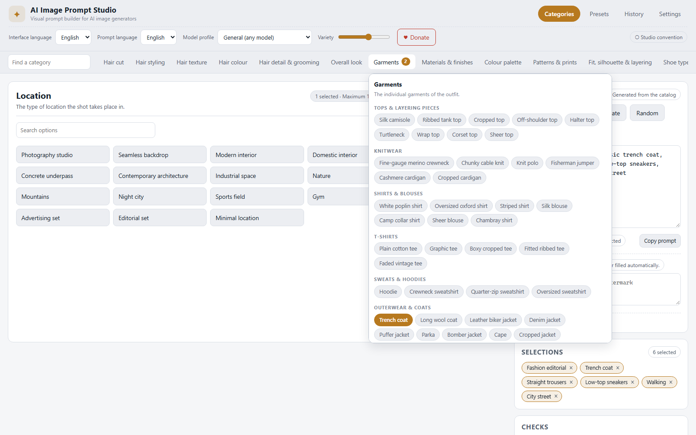

# AI Image Prompt Studio

**A local-first visual prompt builder for AI image generators.**

AI Image Prompt Studio turns a curated, structured catalog of fashion, styling,
photography and lighting vocabulary into a precise, ready-to-paste image prompt.
You pick options in independent categories; the app assembles them into a clean
comma-separated prompt in one click. No API key, no model download, no account —
everything runs in your browser and works offline once loaded.

> **Live demo:** <https://sasxdj-cmyk.github.io/ai-image-prompt-studio/>
> *(runs in the browser, no install — [run it locally](#quick-start) if you prefer)*


---

## Table of contents

- [Highlights](#highlights)
- [Quick start](#quick-start)
- [How the generator works](#how-the-generator-works)
- [Categories](#categories)
- [Catalog](#catalog)
- [Model profiles](#model-profiles)
- [Languages](#languages)
- [Presets, history and export](#presets-history-and-export)
- [Catalog updates](#catalog-updates)
- [Project structure](#project-structure)
- [Scripts](#scripts)
- [Testing](#testing)
- [Privacy](#privacy)
- [Known limitations](#known-limitations)
- [Roadmap](#roadmap)
- [Contributing](#contributing)
- [License](#license)

---

## Highlights

- **72 categories, 803 ready-to-use options** shipped with the app — nothing to
  type by hand on the first run.
- **A category bar like the favourites bar of a browser**: every category is a
  tab at the top, the selected one is highlighted, and hovering opens a dropdown
  with its options, grouped by subgroup. You pick directly from the dropdown.
- **One click generation**: the prompt is assembled deterministically from the
  current selections, in a logical order, with no duplicated or contradictory
  information.
- **Independent categories**: changing the shoes never clears the pose, the
  lighting or the wardrobe.
- **Selections as tags**: every chosen option becomes a tag with an ×, so a
  change of mind is one click away.
- **Editable output**: the generated prompt is a normal text field. Hand-written
  edits are protected — the app asks before replacing them.
- **Conflict and redundancy detection**: incompatible combinations (a dress with
  a top) and repeated wording are reported, and the conflicting fragment is
  left out of the prompt while the selection stays visible.
- **Random**: a coherent random combination from the local catalog, with a
  configurable level of variety. No remote service, no AI model.
- **Model profiles** for Z-Image-Turbo, FLUX.1 [schnell], Qwen-Image-2.1,
  FLUX.2 and FLUX 3 Image Klein, each with the source of its information and a
  verification status.
- **English and Italian** interface, with the prompt language configurable
  independently from the interface language.
- **Local persistence**: preferences, presets, history and the current session
  are stored in `localStorage`. Corrupted data is detected and recovered from.
- **Offline capable**: a service worker caches the app shell, so the studio keeps
  working without a connection.
- **Updateable catalog**: new content can be shipped as a versioned JSON package
  and imported or downloaded — without reinstalling the application and without
  downloading executable code.

## Quick start

Requirements: **Node.js 20.19+** (Node 22 or 24 recommended) and npm.

```bash
git clone <your-fork-or-clone-url>
cd ai-image-prompt-studio
npm install
npm run dev        # development server on http://localhost:5173
```

Production build and local preview:

```bash
npm run build      # type-check + bundle into dist/
npm run preview    # serve the production build on http://localhost:4173
```

The built `dist/` folder is a plain static site: it can be hosted on any static
host (GitHub Pages, Netlify, S3, a local folder). Because the asset paths are
relative, it also works from a subdirectory.

## How the generator works

1. You select options inside any number of categories.
2. **Generate prompt** reads the active selections and the active model profile.
3. The engine:
   - orders the fragments by category (subject → body → appearance → hair →
     wardrobe → footwear → accessories → pose → scene → photography → lighting →
     style), and inside a category by the catalog order;
   - removes entries that exceed the limit of their category;
   - removes entries that contradict an already selected one (for example a
     dress next to a top) and reports the conflict;
   - removes repeated wording, including synonyms declared in the catalog;
   - joins the remaining fragments with `, `, without doubled or trailing
     separators.
4. The result appears in the editable prompt field.

The generation is **deterministic**: the same selections and profile always
produce the same prompt. No AI model is ever called.

**Manual edits.** As soon as you type in the prompt field it is marked
*Manually edited* and the *Generate prompt* button asks for confirmation before
replacing your text. If you change a selection after generating, the app shows a
"regenerate" hint and leaves your text untouched.

**Negative prompt.** The negative prompt is a separate, optional field. It is
never filled automatically with a generic list.

**No invented content.** Only what you selected is added. Terms such as
"masterpiece", "8K" or "ultra detailed" are not injected: the quality boosters
in `finish.boost` are opt-in like any other category.

## Categories

Every category is independent and has its own tab in the bar at the top, like
the favourites bar of a browser. The selected category is highlighted, and
hovering a tab opens a dropdown with its options, grouped by subgroup: you can
pick straight from the dropdown, or open the category in the main panel for
the full view with its own search.

The category tree follows the eleven groups of the catalog:

| Group | Categories | Options |
| --- | --- | --- |
| Subject & character | 5 | 54 |
| Body & proportions | 6 | 42 |
| Skin, face & eyes | 14 | 105 |
| Hair & grooming | 6 | 58 |
| Clothing | 6 | 226 |
| Shoes & footwear | 3 | 55 |
| Accessories | 6 | 58 |
| Pose & composition | 7 | 50 |
| Setting & scene | 3 | 37 |
| Photography & lighting | 14 | 101 |
| Style & finish | 2 | 17 |

Clothing is the deepest area: `wardrobe.garments` carries 15 subgroups (tops,
knitwear, shirts, T-shirts, sweats, outerwear, tailoring, dresses, trousers,
skirts, denim, sportswear, streetwear, business, eveningwear) and the dress
subgroup is declared mutually exclusive with the others.

Shoes are a first-class category with their own type, silhouette/sole and
material sub-categories — not an accessory footnote.



## Catalog

The catalog is **data, not code**. It is split in two:

- `src/catalog/manifest.ts` — the structure: identity, order, control type,
  limits and subgroups of every category;
- `src/catalog/data/*.json` — the content: the options themselves, with an
  English and an Italian label and prompt fragment, tags and provenance.

The two are merged and validated at start-up by `src/catalog/builtin.ts`.
Adding an option, a category or a translation never requires touching a
component.

Every entry carries a stable id, a label, the prompt fragment it contributes,
optional tags, synonyms, conflict and requirement rules, a randomiser weight, a
colour (for swatches) and a provenance note. See
[docs/CATALOG.md](docs/CATALOG.md) for the full field reference and
[docs/ADDING_CATEGORIES.md](docs/ADDING_CATEGORIES.md) for a step-by-step guide.

The vocabulary is general descriptive language, written from domain knowledge
and checked against the references listed in
[docs/research/terminology-notes.md](docs/research/terminology-notes.md), which
also explains what was deliberately left out (brand names, product names,
seasonal claims) and why.

Six entries are currently marked `verified`: each one carries its own source
URL and consultation date, and a test fails if that provenance is missing or
out of sync with the data.

## Model profiles

A profile changes *how* a prompt is assembled for a specific model. It defines
the order of the categories, the categories that are not sent, the documented
support for a negative prompt and the prompt style.

| Profile | Reference | Verification |
| --- | --- | --- |
| General (any model) | Any text-to-image model | Studio convention |
| Z-Image-Turbo | `Tongyi-MAI/Z-Image-Turbo` (Apache-2.0) | Verified against the official repository |
| FLUX.1 [schnell] (FLUX.1 Turbo) | `black-forest-labs/FLUX.1-schnell` (Apache-2.0) | Verified against the official model card |
| Qwen-Image-2.1 | `Qwen/Qwen-Image-2.1` (Qwen Research License) | Verified against the official model card |
| FLUX.2 (dev / klein) | `black-forest-labs/FLUX.2-dev`, `FLUX.2-klein` | Verified against the official repository |
| FLUX 3 Image Klein | `black-forest-labs/flux-3-image-klein` (FLUX Kommunity License) | Verified against the official announcement |

Changing the profile **never clears your selections**: it changes the order and
the content that is sent, and the app reports categories the profile does not
support. Where a behaviour is not documented by the vendor, the profile says so
instead of guessing — for example, FLUX.1 [schnell] and Z-Image-Turbo run
without classifier-free guidance, so the profiles mark the negative prompt as
not effective and the app warns you.

The exact sources, dates and quoted facts are listed in
[docs/research/model-profiles.md](docs/research/model-profiles.md).

## Languages

Three independent language settings:

- **Interface language** — English or Italian, switchable at any time without
  losing the selections.
- **Prompt language** — the language of the generated prompt fragment. English
  is the default, because the model profiles are documented in English and
  technical terms are not translated when it would reduce precision.
- **Catalog language** — every option carries both an English and an Italian
  label and prompt fragment.

All interface strings live in `src/i18n/en.ts` and `src/i18n/it.ts`. A unit
test fails if the two dictionaries drift apart. See
[docs/TRANSLATIONS.md](docs/TRANSLATIONS.md).


## Presets, history and export

- **Presets**: save the current selection set under a name, reload it, duplicate
  it, delete it, or export and import the whole collection as JSON. Loading a
  preset restores the selections without touching the catalog, the translations
  or the preferences.
- **History**: the last 50 generated prompts of the current browser, with a
  button to reload one of them.
- **Copy**: copies the positive prompt, or the positive plus the negative prompt
  when a negative prompt exists. The button reports success or failure.

## Catalog updates

The bundled catalog is always complete: the core features never need a
connection.

- **Import a package**: a validated JSON file replaces the entries of the
  categories it contains. The current version is kept as a rollback point.
- **Rollback**: one click restores the previous catalog version.
- **Online check (optional, off by default)**: the app can read a JSON manifest
  from a URL you configure, compare the versions and download a package. It
  only ever reads JSON data — no code is downloaded or executed, and the feature
  is disabled until you explicitly enable it.

The package format, the version rules and the publication procedure are
documented in [docs/CATALOG_PACKAGES.md](docs/CATALOG_PACKAGES.md) and
[docs/DATA_FORMAT.md](docs/DATA_FORMAT.md).

## Project structure

```
ai-image-prompt-studio/
├─ index.html                  application shell
├─ public/sw.js                service worker (offline cache)
├─ src/
│  ├─ main.tsx                 entry point, service worker registration
│  ├─ styles.css               design system and responsive layout
│  ├─ catalog/                 data model, manifest, validation, content
│  │  ├─ types.ts              CategoryDef, CatalogEntry, ModelProfile, ...
│  │  ├─ manifest.ts           structure of every category
│  │  ├─ validate.ts           schema validation and reporting
│  │  ├─ builtin.ts            merges manifest + data into a catalog
│  │  └─ data/*.json           the catalog content
│  ├─ engine/                  prompt engine
│  │  ├─ prompt.ts             assembly, ordering, conflict handling
│  │  ├─ dedupe.ts             normalisation and redundancy detection
│  │  ├─ compatibility.ts      conflicts, requirements, sanitising
│  │  └─ random.ts             seeded randomiser
│  ├─ models/profiles.ts       model profiles with their sources
│  ├─ i18n/                    en.ts, it.ts, translation helpers
│  ├─ state/                   reducer, provider, local persistence
│  ├─ updates/                 catalog package, manifest, rollback
│  ├─ ui/                      React components
│  └─ clipboard.ts             clipboard helper
├─ docs/                       documentation and screenshots
└─ package.json
```

The engine has no dependency on React, and the catalog has no dependency on
the engine: the two communicate through plain data structures, which is what
makes the engine and the catalog testable in isolation.

## Scripts

| Command | Description |
| --- | --- |
| `npm run dev` | development server with hot reload |
| `npm run build` | type-check and build the production bundle in `dist/` |
| `npm run preview` | serve the production build locally |
| `npm run typecheck` | TypeScript project references check |
| `npm run lint` | ESLint over the whole project |
| `npm run test` | run the test suite once |
| `npm run test:watch` | run the tests in watch mode |
| `npm run verify` | lint + typecheck + test + build |

## Testing

The suite has **137 automated tests** (12 files) covering, among others:

- generation with no selection, one category and many categories;
- logical ordering and comma separation, without doubled or trailing separators;
- removal of duplicated and synonymous fragments;
- empty categories and selections that no longer exist;
- conflicts, mutually exclusive groups and missing requirements;
- the randomiser (validity, limits, reproducibility, catalog immutability);
- "clear all" not touching the settings, the catalog or the presets;
- clipboard copy, including the failure path;
- manual editing of the prompt and its protection;
- selections surviving a model profile or language change;
- missing translations;
- local persistence, recovery from corrupted data and version handling;
- catalog validation, package import, rollback and offline behaviour;
- **the catalog provenance rules** (a `verified` entry always has a source with
  a URL and a consultation date);
- **the category bar** (11 component tests in jsdom): the tabs, the highlight of
  the selected category, the dropdown that opens on hover, picking an option
  from the dropdown and the removal of a selection tag;
- **the interface itself** (16 component tests in jsdom): the category panel,
  the generation flow, the single-selection behaviour, the manual-edit
  protection, the clear-all confirmation, the clipboard, the language switch
  and the profile switch;
- **the example files** shipped in `docs/examples`, parsed with the real
  parsers, so an example can never go stale.

```bash
npm test
```

Two ready-to-import files are shipped in [`docs/examples`](docs/examples): a
catalog package and a preset export.

The application was additionally verified end-to-end in a real browser
(Chromium, 30 automated checks) covering the category bar, the hover dropdown,
the tag removal, the generation flow, the manual-edit protection, the
randomiser, the language switches, the profile switch, "clear all", presets and
the absence of console errors.

## Privacy

Everything happens in your browser. Selections, presets, preferences and the
history are stored in `localStorage` and are never sent to a server. There is no
telemetry, no analytics and no tracking. The only optional network access is
the catalog update check, which is disabled by default and only reads a JSON
manifest from an address you configure.

## Known limitations

- The catalog wording is descriptive vocabulary, not a promise about what a
  given model will render. No setting in the app guarantees a specific result.
- Model profiles encode documented behaviour (step counts, guidance, prompt
  length limits). They do not replace reading the vendor documentation.
- The catalogue update mechanism can replace the content of existing categories;
  introducing a brand new category still requires a release of the application
  (the structure lives in the manifest).
- The interface is tested in Chromium. It follows standard CSS and should work
  in any modern browser, but only Chromium was used for the automated
  end-to-end run.
- The prompt is English by default. The Italian prompt fragments are available
  but are not the recommended choice for most models.

## Roadmap

- A packaged desktop build (Tauri or Electron) around the same front-end.
- More model profiles, each verified against its own documentation.
- Community catalog packages with a signed manifest.
- Batch generation of prompt variations from a single selection set.

## Contributing

Contributions are welcome, especially catalog content. Read
[CONTRIBUTING.md](CONTRIBUTING.md) and [docs/ADDING_CATEGORIES.md](docs/ADDING_CATEGORIES.md)
first: the catalog has a strict schema, and the tests will tell you when
something is off.

```bash
npm install
npm run verify
```

## License

**MIT** — free and open source. You can use, modify, distribute and sell it,
including in commercial projects, as long as the copyright notice is kept.

The full text is in [LICENSE](LICENSE).

The project is not funded by ads and does not track anything. If it is useful
to you, you can support it with a [PayPal donation](https://paypal.me/SalvaCucca)
using the **Dona / Donate** button in the header — that is the only external
service the application links to, and clicking it is optional.

Third-party dependencies keep their own licenses: React and Vite (MIT),
TypeScript (Apache-2.0), ESLint and typescript-eslint (MIT).
